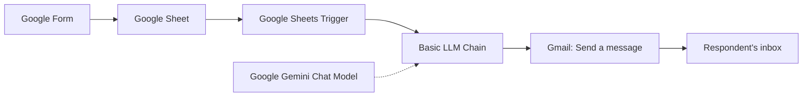

# AI-Automation
This document the learning process of AI automation. this mark the first workflow I executed. The workflow consist of a schedule trigger(google sheet) which is connected to a Basic LLM engine and Gemini and Gmail (send message).
# 📧 AI-Powered Welcome Email Automation (n8n + Gemini + Gmail)
An automation that sends a **personalized, AI-written welcome email** to everyone who submits a Google Form, with no manual work after setup.
When someone fills the form, their response lands in Google Sheets. n8n detects the new row, Google Gemini writes a welcome message based on what the person is interested in, and Gmail sends it to them automatically.

# 🎯 Problem It Solves
Manually welcoming every new subscriber or form respondent is slow and easy to forget. Generic auto-replies feel cold. This workflow:
- Responds to every new sign-up automatically
- Personalizes each message using the respondent's own answers
- Saves time while keeping the tone warm and human
---
# 🔄 How It Works

**Google Form**: a person submits their name, email, and interest.

**Google Sheets Trigger**: n8n watches the response sheet and fires when a new row is added.

**Basic LLM Chain**: builds a prompt using the respondent's details.
 
**Google Gemini Chat Model**: the AI model connected to the chain that generates the email text.
 
**Gmail (Send a message)**: sends the generated message to the respondent's email address.


---
## 🛠️ Tech Stack
| Tool | Purpose |
|------|---------|
| [n8n](https://n8n.io) | Workflow automation platform |
| Google Forms | Collects respondent details |
| Google Sheets | Stores form responses |
| Google Gemini | Generates the personalized welcome message |
| Gmail | Sends the email |
---
## ⚙️ Node Configuration
### 1. Google Sheets Trigger
- **Trigger On:** Row Added
- **Document:** the Google Sheet linked to the form
- **Sheet:** Form responses 1
- Run **Fetch Test Event** to load a sample row while building
### 2. Basic LLM Chain
- **Source for Prompt:** Define below
- **Prompt example:**
You are a friendly and professional welcome assistant. Generate a personalised welcome message using the information below.
Name: {{ $json['Full name'] }}
Email: {{ $json['Email Account'] }}
Interest: {{ $json['What are you interested in'] }}
Welcome the person warmly. Mention their area of interest. Keep the message engaging, natural and professional. Do not invent personal information. Return only the welcome message.
```
```
### 3. Google Gemini Chat Model (sub-node)
- Attached to the **Chat Model** connector of the Basic LLM Chain
- **Credential:** Gemini API key from [Google AI Studio](https://aistudio.google.com)
- **Model:** a Gemini Flash model
### 4. Gmail: Send a message
- **Resource:** Message
- **Operation:** Send
- **To:** `{{ $('Google Sheets Trigger').item.json['Email Account'] }}`
- **Subject:** `Welcome Message`
- **Email Type:** Text
- **Message:** `{{ $json.text }}`
> The recipient is read from the trigger node because the LLM chain's output only contains the generated text, not the original sheet columns.
---
## 🚀 Setup Guide
1. **Create a Google Form** with at least an email field and an interest question, and link it to a Google Sheet.
2. **Open n8n** and create a new workflow.
3. **Add the nodes** in the order above and connect the Gemini Chat Model under the Basic LLM Chain.
4. **Add credentials:** Google Sheets (OAuth), Gemini (API key), and Gmail (OAuth).
5. **Test** by submitting the form, then run the workflow and check the inbox.
6. **Activate** the workflow so it runs automatically.
---
## 🐞 Troubleshooting
| Error | Cause | Fix |
|-------|-------|-----|
| `Bad request - Invalid To header` | The email in the sheet is incomplete (e.g. `name@gmail` with no `.com`) | Correct the address in the sheet and re-run. Prevent it by enabling **Response validation → Text → Email** on the Google Form. |
| Empty recipient | Column name in the expression doesn't match the sheet | Match the header exactly, including spaces and capitalization |
| Line breaks collapse | Gmail sends HTML by default | Set Email Type to Text, or ask the model to return simple HTML |
| Same email sent twice | Old rows re-triggered during testing | Keep the workflow active once and avoid re-running on old rows |
---
## 📚 What I Learned
- How **triggers** start a workflow automatically from a data event
- How to connect an **AI model as a sub-node** to a Basic LLM Chain
- Using **expressions** to pass data between nodes
- Why the data from earlier nodes must be referenced explicitly (`$('Node Name')`)
- Reading n8n error messages and tracing them back to the source data
---
## 🔮 Future Improvements
- Add an **IF node** to validate email addresses before sending
- Log sent emails in a Google Sheet column (e.g. "Email Sent ✅")
- Send different messages depending on the respondent's interest
- Add a **Wait** and a follow-up email a few days later
---
## 👤 Author
**Aleshinloye Yusuf Olatunji** (Alesh)
Data analyst in training, educator, and Data analyst**.
---
⭐ If you found this useful, feel free to star the repo.
